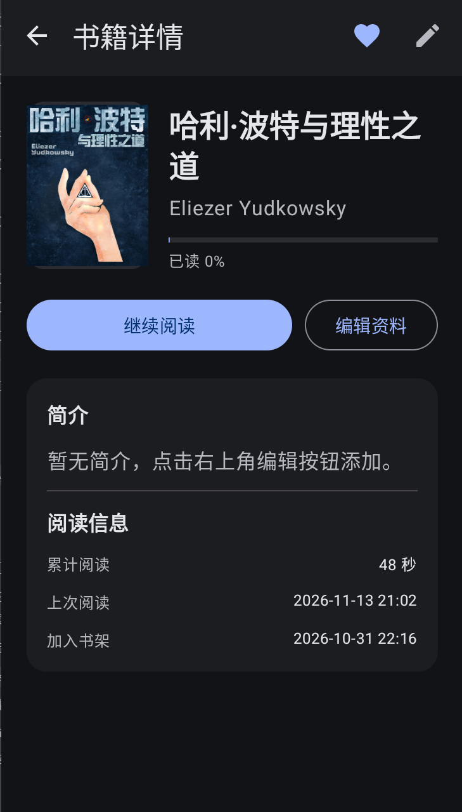
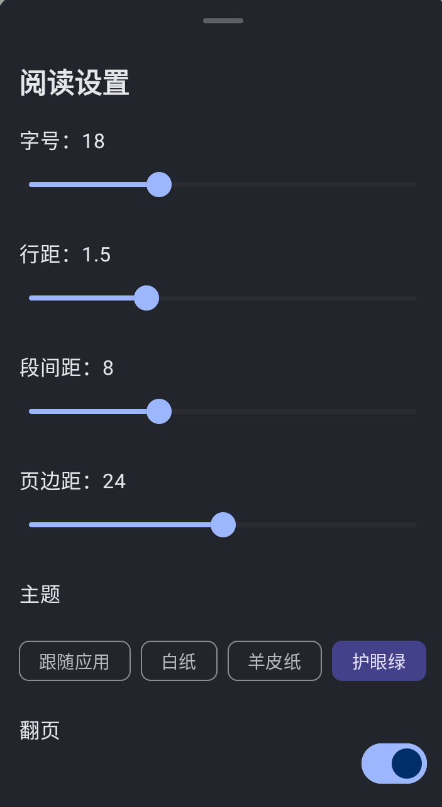

# 原阅 · OriginRead

> 一个安静、克制的 Android 阅读器。

[](CHANGELOG.md)
[](https://github.com/XSimplxe/OriginRead/actions/workflows/android.yml)
[](https://developer.android.com)
[](https://kotlinlang.org)
[](https://developer.android.com/jetpack/compose)
[](LICENSE)

原阅把 RSS、热榜、在线书源和本地书库收进同一个界面。它不追求信息密度，而是让阅读这件事少一点打扰。

所有数据保存在本地，没有账号，没有遥测，也没有服务器。

> 当前版本：**1.3.1** · 安静地读一点东西

## 界面

| 书架 | 书籍详情 | 阅读 | 阅读设置 |
|:---:|:---:|:---:|:---:|
|  |  |  |  |

<p align="center"><sub>书架 · 详情 · 阅读 · 阅读设置</sub></p>

## 特性

**阅读**

- 本地书库：TXT、EPUB、PDF、DOCX、RTF、HTML、FB2、MOBI、AZW3、Markdown。
- 图片型 EPUB 漫画自动识别，整页渲染，支持上下滚动和左右翻页。
- 横向自由翻阅支持整本本地书连续翻页，不再在章节末尾停住；在线书滑到章节末尾会自动加载下一章。
- 横向翻页、纵向滚动、自由滚动；横向自由翻阅是真正的整本连续阅读。
- 听书：系统 TTS、多音色、语速调节、暂停/继续和朗读进度；听书设置也可在设置中调整。
- AI 伴读：围绕当前章节提问、总结、解释人物与时间线。
- 笔记与书签：长按正文高亮、划线、写笔记；再次长按可取消标记。漫画页支持高亮、页面笔记和自由涂鸦。
- 五种字体风格、字号、行距、段间距、页边距、首行缩进独立可调。
- 深色模式覆盖首页、书架、书源、设置、弹窗和阅读页。

**书库**

- 书架统一展示本地书与在线收藏，阅读摘要把在线收藏一起统计；在线小说和漫画合并到「在线」。
- 阅读摘要：藏书、在读、已读完、收藏和累计阅读时长。
- 按书名、作者、简介、标签搜索；收藏夹与标签筛选。
- 书籍详情页支持封面、作者、简介、阅读信息和手动编辑。
- 在线书详情页可直接收藏并加入书架。

**首页**

- 按时间与昵称问候。
- 每日资讯摘要保留，并提供 AI 摘要。
- 向下浏览按时间排列的 RSS 资讯流。

**外观与内容源**

- 浅色、深色、跟随系统；六个颜色角色的独立调色盘。
- 微博、百度、知乎、哔哩哔哩热榜聚合。
- 自定义 RSS 订阅；支持单/多书源 JSON、JSONL、Legado 分享链接和本地文件。
- 在线书源与漫画源；书源导入前可分析、检测可用性并批量添加。

**首次使用**

- 快速开始：首次进入时在介绍页内直接配置昵称、界面主色、RSS、书源和 AI API Key；可跳过单项，跳过入口在右下角。
- 四页新手引导，可随时跳过，之后在设置中修改。

## 听书音色 JSON

阅读页 → 耳机按钮 → 「导入 JSON」，可为系统 TTS 引擎补充引擎与音色的显示名。

```json
{
  "engines": [
    {
      "package": "com.google.android.tts",
      "name": "Google 语音服务",
      "voices": [
        {
          "name": "cmn-cn-x-ccc-local",
          "label": "中文女声 · 离线",
          "locale": "zh-CN"
        }
      ]
    }
  ]
}
```

- `package`：已安装的 TTS 引擎包名，必填。
- `voices[].name`：系统音色 ID，必填。
- 导入只补充展示信息，实际发音由设备 TTS 引擎提供。
- 示例：[docs/tts-voices.sample.json](docs/tts-voices.sample.json)。

## 安装

从 [Releases](https://github.com/XSimplxe/OriginRead/releases) 下载 APK。每次发版同时提供通用包和 32 位 `armeabi-v7a` 包。

- 最低 Android 8.0（API 26），目标 Android 15（API 35）
- 正式包约 8 MB（R8 压缩）；仅 32 位设备选择 `YuanyueReader-<版本>-armeabi-v7a.apk`
- 升级安装请保留同一签名；正式包使用 v2 + v3 签名

## 从源码构建

需要 JDK 17、Android SDK 35。

```bash
git clone https://github.com/XSimplxe/OriginRead.git
cd OriginRead
./gradlew assembleDebug
```

正式包：

```bash
./gradlew assembleRelease
```

32 位（armeabi-v7a）：

```bash
./gradlew assembleRelease -Pabi32
```

签名依赖本地 `release/keystore.properties` 与 `release/yuanyue-release.jks`，不会提交到仓库。

单元测试：

```bash
./gradlew testDebugUnitTest
```

## 技术栈

| 层 | 选型 |
|---|---|
| 语言 | Kotlin |
| UI | Jetpack Compose + Material 3 |
| 本地数据 | Room + DataStore |
| 网络 | OkHttp + Jsoup |
| 图片 | Coil |
| PDF | PDFBox-Android |

## 项目结构

```text
app/src/main/java/com/yuanyue/reader/
├── core/        # 依赖容器、Room、网络
├── data/        # 仓库、书源规则、格式解析
├── model/       # 数据模型
├── ui/          # 首页、书架、阅读、漫画、设置
└── MainActivity.kt
```

## 设计取向

- **Local-first**：书籍、书源、RSS、阅读进度与偏好保存在本机。
- **内容与界面分离**：规则、解析、渲染独立，方便扩展。
- **克制的视觉**：低饱和配色与留白，让文字成为主角。
- **可逆的定制**：主题、配色、排版都可以恢复默认。

## 已知限制

- PDF 仅提取可复制文字，扫描版暂不支持 OCR。
- MOBI/AZW3 仅支持无 DRM、非 HUFF/CDIC 压缩的文件；遇到不支持的压缩会提示转换 EPUB。
- 旧版 `.doc` 请另存为 `.docx`。
- 听书依赖系统 TTS 引擎和中文语音包；当前只朗读当前章节。
- AI 功能需要自己的 OpenAI 兼容 API Key；Key 只保存在本机。
- 笔记/高亮/划线目前以页面或自然段为单位，不是任意字符选择。
- 图片型 EPUB 采用启发式识别；旧版本导入的漫画 EPUB 建议重新导入。

## 贡献

欢迎 issue、书源规则和格式解析方面的改进。提交前请阅读 [CONTRIBUTING.md](CONTRIBUTING.md)。

如果这个项目对你有帮助，给一个 Star 是最好的支持。

## 许可

[MIT](LICENSE) © 2026 Yuanyue Reader contributors

## 致谢

[Jetpack Compose](https://developer.android.com/jetpack/compose) · [Coil](https://coil-kt.github.io/coil/) · [OkHttp](https://square.github.io/okhttp/) · [Jsoup](https://jsoup.org/) · [PDFBox-Android](https://github.com/TomRoush/PdfBox-Android) · [Legado](https://github.com/gedoor/legado) 书源格式

完整版本记录见 [CHANGELOG.md](CHANGELOG.md)。
